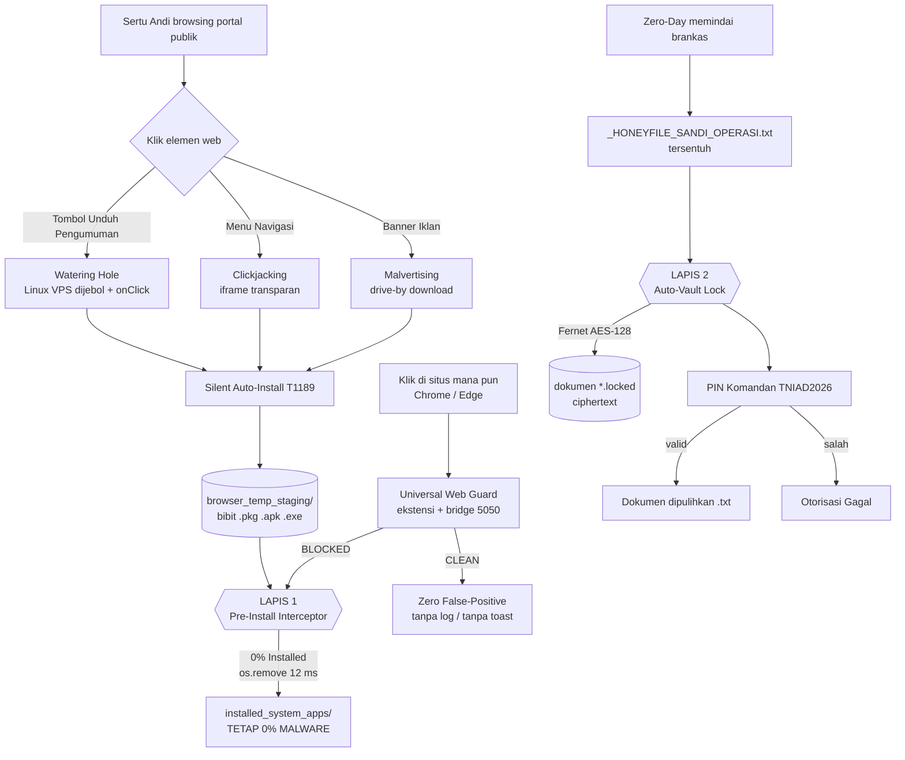

# 🛡️ WIRA-SHIELD

> **Waspada Interseksi Runtime & Automated Shield**

**Tagline:** *Cegat malware pada posisi 0% ter-install. Kunci rahasia sebelum dicuri.*

| Identitas | Keterangan |
| --- | --- |
| **Nama Purwarupa** | WIRA-SHIELD (Waspada Interseksi Runtime & Automated Shield) |
| **Kompetisi** | Kartika Cyber Hackathon 2026 — PUSSIBERAD TNI AD & CODEPOLITAN |
| **Kategori** | **02 — Defensive Shield (Penangkalan)** |
| **Lingkungan** | Windows (lokal) & Linux (Streamlit Community Cloud) |
| **PIN Komandan** | `TNIAD2026` |
| **Pemetaan Ancaman** | Drive-By Compromise — MITRE ATT&CK **T1189** |

Purwarupa ini adalah **sistem Endpoint Detection & Response (EDR) dua lapis** untuk perangkat prajurit. Seluruh "malware" hanyalah **file teks simulasi** di dalam sandbox terkunci — tidak ada biner berbahaya yang dieksekusi, tidak ada koneksi C2, tidak ada persistensi di luar folder sandbox.

---

## Daftar Isi

1. [Studi Kasus Nyata — Skenario Sertu Andi](#1-studi-kasus-nyata--skenario-sertu-andi)
2. [Akar Masalah Teknis](#2-akar-masalah-teknis)
3. [Arsitektur Pertahanan 2 Lapis & Universal Web Guard](#3-arsitektur-pertahanan-2-lapis--universal-web-guard)
4. [Cakupan Multi-Device Endpoint](#4-cakupan-multi-device-endpoint)
5. [Panduan Menjalankan Sistem](#5-panduan-menjalankan-sistem)
6. [Skenario Pengujian Dewan Juri](#6-skenario-pengujian-dewan-juri)
7. [Arsitektur Kode & Kontrak Path](#7-arsitektur-kode--kontrak-path)
8. [Keamanan Simulasi & Sandbox Guardrail](#8-keamanan-simulasi--sandbox-guardrail)

---

## 1. Studi Kasus Nyata — Skenario Sertu Andi

### 08:47 WIB — Pos Komunikasi Kodim

Sertu Andi, NCO Komunikasi satuan, membuka laptop dinas Windows untuk mengecek pengumuman setoran latihan di portal informasi instansi yang biasa ia akses setiap pagi. Portal itu **sah** — sertifikat HTTPS valid, domain sudah bertahun-tahun dipakai satuan, dan tidak masuk daftar hitam firewall.

Ia mengklik tombol **"Unduh Pengumuman Resmi"**.

Yang Sertu Andi tidak tahu: semalam, peretas telah **menjebol server Linux VPS** penyedia hosting portal tersebut, menyusup ke folder proyek, menyuntikkan kode jahat ke fungsi `onClick` tombol unduh, lalu me-restart layanan web. Saat tombol resmi itu diklik, browser secara **diam-diam** mengunduh dan hampir memasang *Remote Access Trojan* — **tanpa satu pun notifikasi izin instalasi**.

Itu bukan cerita fiksi. Itu pola **Watering Hole + Silent Auto-Install (MITRE ATT&CK T1189)** yang justru paling efektif justru karena korbannya adalah orang yang bekerja dengan benar: membuka situs resmi, di jam kerja, di jaringan yang dianggap aman.

### 08:47:00.001 — Jika Tidak Ada WIRA-SHIELD

Bibit backdoor `silent_rat_vps_exploit.pkg` mendarat di perangkat, installer berjalan senyap, RAT mendapat akses penuh. Dalam hitungan menit, folder dokumen rahasia satuan — konfigurasi pertahanan jaringan, titik koordinat komando, inventaris Alutsista — dapat dibaca, disalin, atau dienkripsi peretas.

**Firewall tidak melihat apa-apa.** Antivirus menunggu *signature* yang mungkin belum ada. URL blacklisting meloloskan trafik karena domain dianggap sah. TNI AD **tidak memiliki kendali** atas keamanan sisi server website publik di luar jaringan militer.

### 08:47:00.012 — Dengan WIRA-SHIELD

Bibit installer mendarat di ruang transit `browser_temp_staging/`. Sebelum sempat menjadi proses, **Pre-Install Interceptor memutus instalasi pada posisi 0%** dan menghapus bersih file bibit. Sistem utama tetap 100% bersih. Sertu Andi bahkan tidak perlu tahu ia baru saja menjadi target.

Kalau malam itu pula ada serangan Zero-Day yang menyapu folder rahasia dan menyentuh file umpan `_HONEYFILE_SANDI_OPERASI.txt`, seluruh dokumen asli **otomatis terkunci Fernet AES-128** dalam hitungan milidetik. Brankas hanya terbuka dengan PIN Otorisasi Komandan.

> **WIRA-SHIELD ada untuk Sertu Andi** — dan ribuan prajurit lain yang satu-satunya "kesalahan" adalah mengklik tombol resmi di situs yang telah dijebol dari sisi server.

---

## 2. Akar Masalah Teknis

### 2.1 Faktor Manusia: Social Engineering

Pintu masuk paling rentan bukan firewall pusat, melainkan **perangkat prajurit** yang dimanipulasi saat beraktivitas di portal web publik. Empat vektor yang dipakai:

| # | Vektor | Cara Kerja | Payload Simulasi |
| --- | --- | --- | --- |
| 1 | **Watering Hole via Pembobolan Linux VPS** | Peretas menjebol VPS website instansi, menyuntik `onClick` pada tombol resmi, me-restart layanan. Klik prajurit = unduh diam-diam. | `silent_rat_vps_exploit.pkg` |
| 2 | **Clickjacking / UI Redressing** | Iframe transparan menempel di atas menu navigasi. Klik yang tampak sah mengunduh spyware. | `transparent_menu_spyware.apk` |
| 3 | **Malvertising** | Exploit diselundupkan lewat banner iklan portal berita nasional. | `ad_banner_infostealer.exe` |
| 4 | **Zero-Day Honeyfile** | Malware yang sudah di perangkat menyapu folder rahasia dan membaca file umpan. | Akses ke `_HONEYFILE_SANDI_OPERASI.txt` |

### 2.2 Silent Auto-Install (T1189)

*Drive-By Compromise* membuat browser mengeksekusi pengunduhan **dan** pemasangan aplikasi mata-mata tanpa memunculkan dialog izin. Korban tidak akan melihat UAC, tidak akan melihat installer, tidak akan sadar.

### 2.3 Mengapa Firewall & Antivirus Biasa Gagal

- **URL blacklisting** meloloskan domain sah yang telah disusupi sisi server.
- **Antivirus signature** kalah cepat oleh exploit zero-day / polimorfik.
- **Notifikasi instalasi** tidak muncul karena *silent install*.
- **TNI AD tidak mengendalikan** server website publik di luar jaringan militer.

WIRA-SHIELD memindahkan titik pertahanan ke **perangkat prajurit** — satu-satunya titik yang benar-benar bisa dikendalikan satuan.

---

## 3. Arsitektur Pertahanan 2 Lapis & Universal Web Guard

### 3.1 Lapis 1 — Pre-Install Staging Interceptor (0% Installed)

Setiap aplikasi yang ter-install otomatis dari browser **wajib melewati** `browser_temp_staging/` sebelum masuk `installed_system_apps/`.

WIRA-SHIELD memindai ruang transit secara real-time. File ber-ekstensi `.pkg`, `.apk`, `.exe`, `.bat`, `.sh`, `.py`, atau `.bin` langsung:

1. Dideteksi sebagai *unauthorized installer*.
2. **Diputus pada 0% Installed** (*Blocked at Staging*) — tidak pernah disalin ke sistem utama.
3. **Dihapus permanen** dari staging (`os.remove`) dalam hitungan milidetik (telemetri **12 ms**).

Hasil pembuktian: `installed_system_apps/` **selalu 100% bersih**.

### 3.2 Universal Web Guard — Ekstensi Browser + Bridge Lokal

Lapis 1 tidak berhenti di dashboard. **Universal Web Guard** memantau klik di **semua situs web HTTPS/HTTP** yang dibuka prajurit:

| Komponen | Peran |
| --- | --- |
| `wira_browser_extension/` | Ekstensi Chrome/Edge Manifest V3. Mendeteksi klik pada `a`, `button`, `img`, iklan, dan menu di situs mana pun. |
| `wira_live_bridge.py` | Daemon lokal `http://127.0.0.1:5050`. Menerima laporan klik, memutus CLEAN/BLOCKED, meneruskan ke mesin intersepsi. |
| `background.js` | Service worker yang melakukan `fetch` ke bridge agar bebas blokir *Mixed-Content* HTTPS. |

**Prinsip Zero False-Positive (bebas Alert Fatigue):**

| Kondisi Klik | Respon | Log? |
| --- | --- | --- |
| Toggle uji **MATI** + href bukan installer | `CLEAN` — tidak ada toast, tidak ada alarm | **Tidak ditulis** |
| Toggle uji **NYALA**, **atau** href mengarah ke `.exe/.apk/.pkg/.bat/.sh/.msi/.scr` | `BLOCKED` — `preventDefault()`, toast **"🛡️ WIRA-SHIELD INTERCEPTED (0% INSTALLED)"**, payload `web_driveby_drop.pkg` dihapus di staging | Ditulis |
| Klik di `localhost` / `127.0.0.1` (dashboard sendiri) | Otomatis diabaikan | **Tidak ditulis** |

Operator tidak akan dibanjiri peringatan palsu setiap kali prajurit membaca berita. Alarm hanya muncul saat ada indikasi *silent installer*.

### 3.3 Lapis 2 — Honey-File Trap & Auto-Vault Lock (Fernet AES-128)

Di dalam `dokumen_rahasia_tni/` ditanam umpan **`_HONEYFILE_SANDI_OPERASI.txt`**.

- Manusia normal tidak akan menyentuhnya.
- Program pencuri data yang menyapu seluruh folder **pasti membacanya**.

Begitu honeyfile tersentuh, seluruh dokumen `.txt` asli dienkripsi **Fernet (AES-128-CBC + HMAC)** menjadi `.locked`. Ciphertext (contoh `gAAAAAB...`) mustahil dibaca peretas. Brankas hanya terbuka dengan **PIN Otorisasi Komandan: `TNIAD2026`**.

### 3.4 Diagram Alur (ASCII)

```
                     SERTU ANDI BROWSING
          (portal berita / instansi di luar jaringan militer)
                                  │
              Klik tombol resmi / menu / iklan
              (Watering Hole │ Clickjacking │ Malvertising)
                                  ▼
              ┌─────────────────────────────────────┐
              │   SILENT AUTO-INSTALL (T1189)       │
              │   tanpa notifikasi izin instalasi   │
              └──────────────────┬──────────────────┘
                                 ▼
   ┌──────────────────────────────────────────────────────┐
   │  LAPIS 1A — UNIVERSAL WEB GUARD (Chrome/Edge)        │
   │  Ekstensi + wira_live_bridge.py @ 127.0.0.1:5050     │
   │  Zero False-Positive: klik bersih TIDAK menulis log  │
   └──────────────────┬───────────────────────────────────┘
                      ▼
        ┌────────────────────────────────────────────┐
        │  LAPIS 1B — browser_temp_staging/          │
        │  Ruang transit bibit malware (0% install)  │
        └──────────────────┬─────────────────────────┘
                           ▼
        ╔════════════════════════════════════════════╗
        ║  PRE-INSTALL INTERCEPTOR                   ║
        ║  [01 ms] Klik terdeteksi                   ║
        ║  [05 ms] Bibit mendarat di staging         ║
        ║  [09 ms] Anomali installer terdeteksi      ║
        ║  [12 ms] INSTALASI DIPUTUS DI 0%           ║
        ║          os.remove() + is_safe_path()      ║
        ╚═══════════════════╦════════════════════════╝
                            │
              DITOLAK ──────╨──────► installed_system_apps/
                                    ├── aplikasi_dinas_tni.sys   (resmi)
                                    ├── komunikasi_taktis.apk    (resmi)
                                    └── MALWARE: TIDAK ADA (0%)

        Sementara itu, di brankas dokumen:

        ┌────────────────────────────────────────────┐
        │  LAPIS 2 — dokumen_rahasia_tni/            │
        │  Strategi_Pertahanan_Siber_2026.txt         │
        │  Data_Logistik_Alutsista.txt                │
        │  _HONEYFILE_SANDI_OPERASI.txt  ← UMPAN      │
        └──────────────────┬─────────────────────────┘
                           │  Zero-Day membaca honeyfile
                           ▼
        ╔════════════════════════════════════════════╗
        ║  AUTO-VAULT LOCK (Fernet AES-128-CBC+HMAC) ║
        ║  *.txt  ──enkripsi──►  *.locked            ║
        ║  Hanya PIN Komandan TNIAD2026 yang membuka ║
        ╚════════════════════════════════════════════╝
```

### 3.5 Diagram Alur (Mermaid)



---

## 4. Cakupan Multi-Device Endpoint

| Profil Perangkat | Kesesuaian Teknis | Perilaku Agen WIRA-SHIELD |
| --- | --- | --- |
| **Laptop & PC Dinas (Windows/Linux)** | IT endpoint penuh | Agen bekerja penuh: mengawasi staging browser, mencegah eksekusi *silent installer*, dan mengunci brankas dokumen rahasia. |
| **Smartphone Prajurit (Android/iOS)** | Batasan OS *Sandboxing* mobile | Agen bekerja sebagai **Mobile Download & Staging Buffer Guard**: menyapu bersih paket `.apk` / script eksploitasi di ruang transit sebelum diproses oleh *package installer* HP. |
| **Perangkat OT / Sensor Markas (Linux Embedded)** | Direktori operasional OT | **Config Integrity Guard**: menjaga integritas direktori operasional dan konfigurasi sistem kontrol satuan dari penyusupan script otomatis. |

Profil dipilih di sidebar dashboard dan tercatat pada setiap log insiden.

---

## 5. Panduan Menjalankan Sistem

### 5.1 Prasyarat

- Python **3.9+** (direkomendasikan 3.10 / 3.11 / 3.13)
- `pip` aktif
- Chrome atau Edge (untuk Live Browser Guard)
- Tanpa database eksternal

### 5.2 Instalasi Dependensi

```bash
cd wira-shield
pip install -r requirements.txt
```

Isi `requirements.txt`:

```
streamlit>=1.32.0
watchdog>=4.0.0
cryptography>=42.0.0
psutil>=5.9.0
```

### 5.3 Mode Cloud / Dashboard Utama

```bash
streamlit run app.py
```

Browser terbuka di `http://localhost:8501`.

Dashboard terbagi dua tab:

| Tab | Nama | Isi |
| --- | --- | --- |
| **Tab 1** | **🛡️ Endpoint Guard & Document Vault (Live System)** | Telemetri real-time staging & sistem utama, pindai file unduhan manual, brankas dokumen live (teks asli vs ciphertext), tambah dokumen, kunci darurat, otorisasi PIN Komandan, log forensik. |
| **Tab 2** | **🧪 Threat Lab & Simulator (Red-Team Testing)** | Empat tombol skenario serangan, konteks MITRE T1189, panduan Live Browser Guard, kredensial PIN. |

Saat aplikasi pertama kali dibuka, `get_system_status()` otomatis memanggil `init_sandbox()` bila folder `sandbox_device_prajurit/` belum ada (folder ini diabaikan Git).

### 5.4 Mode Live Browser Guard (Lokal)

Agar klik nyata di **semua situs web** terpantau:

**Langkah 1 — Jalankan bridge** (terminal terpisah, biarkan hidup):

```bash
python wira_live_bridge.py
```

Bridge mendengar di `http://127.0.0.1:5050`.

**Langkah 2 — Muat ekstensi di Chrome/Edge:**

1. Buka `chrome://extensions` (atau `edge://extensions`).
2. Aktifkan **Developer mode**.
3. Klik **Load unpacked**.
4. Pilih folder **`wira_browser_extension/`**.
5. Pin **🛡️ WIRA-SHIELD Web Guard** ke toolbar.

**Langkah 3 — Konfigurasi popup ekstensi:**

- Pastikan status **🟢 Bridge: CONNECTED**.
- Toggle **🧪 Mode Uji Serangan**:
  - **ON** = setiap klik dianggap tersusupi → dicegat di 0% Installed + toast di browser.
  - **OFF** = hanya tautan installer (.exe/.apk/.pkg/.bat/.sh/.msi/.scr) yang dicegat. Klik lain CLEAN, tanpa log.

**Langkah 4 — Buka situs mana pun** (detik.com, kompas.com, dll.) dan klik elemen web. Hasil:

- **BLOCKED** → toast *WIRA-SHIELD INTERCEPTED (0% INSTALLED)* + entri log di dashboard (tekan **🔄 Sync / Refresh Telemetry** atau tunggu auto-refresh ±2 detik).
- **CLEAN** → tanpa toast, tanpa log (zero false-positive).
- Klik di dashboard `localhost` / `127.0.0.1` **otomatis diabaikan** agar operator tidak mengunci dirinya sendiri.

### 5.5 Kredensial Pengujian

| Kredensial | Nilai |
| --- | --- |
| **PIN Otorisasi Komandan** | `TNIAD2026` |
| Form input | `PIN Komandan` (type: password) |
| Tombol pemulihan | `🔓 Buka Kunci Brankas` |

---

## 6. Skenario Pengujian Dewan Juri

### Langkah 1 — Watering Hole (Pembobolan Linux VPS)

1. Buka **Tab 2 — Threat Lab**.
2. Klik **`🚀 Jalankan Simulasi Watering Hole`**.
3. Pindah ke **Tab 1** (telemetri tetap tampil di atas tab).
4. **Hasil:** LAPIS 1 AKTIF, `silent_rat_vps_exploit.pkg` dihapus di **0% Installed**, `installed_system_apps/` tetap hanya 2 aplikasi resmi, Ancaman Digagalkan +1.

### Langkah 2 — Clickjacking

Klik **`🚀 Jalankan Simulasi Clickjacking`** → `transparent_menu_spyware.apk` dicegat di staging.

### Langkah 3 — Malvertising

Klik **`🚀 Jalankan Simulasi Malvertising`** → `ad_banner_infostealer.exe` dicegat di staging.

### Langkah 4 — Zero-Day Honeyfile + Otorisasi Komandan

1. Klik **`🚨 Picu Serangan Zero-Day Honeyfile`**.
2. **Hasil:** Status **DARURAT**, brankas **TERKUNCI (AES)**, seluruh `.txt` menjadi `.locked` (ciphertext `gAAAAAB...`).
3. Isi PIN **`TNIAD2026`** pada form Otorisasi Komandan (Tab 1) → klik **`🔓 Buka Kunci Brankas`**.
4. **Hasil:** dokumen `.txt` kembali, preview teks asli terbaca.

### Langkah 5 (Opsional) — Live Browser Guard di Situs Nyata

1. Pastikan bridge + ekstensi aktif (Bagian 5.4).
2. Nyalakan **Mode Uji Serangan**.
3. Buka situs berita mana pun, klik menu/tautan.
4. **Hasil:** toast INTERCEPTED di browser + telemetri 0% Installed di dashboard (auto-refresh ±2 detik).
5. Matikan toggle, klik tautan biasa → **CLEAN**, Ancaman tidak bertambah (zero false-positive).
6. Klik di dashboard sendiri → tidak ada intersepsi.

**Opsional — Reset:** klik **`♻️ Reset Environment`** di sidebar untuk mengulang demo dari nol.

---

## 7. Arsitektur Kode & Kontrak Path

### 7.1 Struktur Direktori

```
wira-shield/
├── WIRA_SHIELD_SPEC.md               # Spesifikasi master & kontrak estafet
├── README.md                         # Dokumen ini (Modul 5)
├── .gitignore                        # Abaikan sandbox, venv, bytecode
├── requirements.txt                  # Dependensi Python
├── .streamlit/config.toml            # Tema gelap resmi Streamlit
├── sandbox_setup.py                  # Modul 1: init sandbox + is_safe_path()
├── wira_engine.py                    # Modul 2: Lapis 1 & Lapis 2
├── attack_simulator.py               # Modul 3: 4 skenario serangan
├── app.py                            # Modul 4: Dashboard EDR 2 Tab
├── wira_live_bridge.py               # Universal Web Click Interceptor (5050)
├── wira_browser_extension/           # Ekstensi Chrome/Edge MV3
│   ├── manifest.json
│   ├── background.js
│   ├── content.js
│   ├── popup.html
│   └── popup.js
└── sandbox_device_prajurit/          # Dibuat otomatis — DIABAIKAN GIT
    ├── browser_temp_staging/         # Ruang transit bibit malware
    ├── installed_system_apps/        # Sistem utama (wajib 0% malware)
    ├── dokumen_rahasia_tni/          # Brankas + honeyfile
    ├── security_logs.json            # Log insiden & latensi (ms)
    └── vault.key                     # Kunci enkripsi Fernet
```

### 7.2 Konstanta Path Terkunci (identik di semua modul)

```python
BASE_SANDBOX    = "./sandbox_device_prajurit"
STAGING_DIR     = "./sandbox_device_prajurit/browser_temp_staging"
SYSTEM_APPS_DIR = "./sandbox_device_prajurit/installed_system_apps"
VAULT_DIR       = "./sandbox_device_prajurit/dokumen_rahasia_tni"
HONEYFILE_PATH  = "./sandbox_device_prajurit/dokumen_rahasia_tni/_HONEYFILE_SANDI_OPERASI.txt"
LOG_FILE        = "./sandbox_device_prajurit/security_logs.json"
KEY_FILE        = "./sandbox_device_prajurit/vault.key"
COMMANDER_PIN   = "TNIAD2026"
```

### 7.3 Fungsi Inti

| Modul | Fungsi | Peran |
| --- | --- | --- |
| `sandbox_setup.py` | `is_safe_path(target_path)` | Guardrail: `True` hanya jika path di dalam `BASE_SANDBOX`. |
| `sandbox_setup.py` | `init_sandbox()` | Buat/reset folder, 2 aplikasi resmi, 3 dokumen + honeyfile, kunci Fernet baru, log `[]`. |
| `wira_engine.py` | `intercept_staging(device_profile, attack_source)` | Lapis 1: purge payload mencurigakan, log `0% Installed`. |
| `wira_engine.py` | `lock_vault(reason, device_profile)` | Lapis 2: enkripsi semua `.txt` → `.locked`. |
| `wira_engine.py` | `unlock_vault(pin)` | Pulihkan `.locked` → `.txt` hanya jika PIN == `TNIAD2026`. |
| `wira_engine.py` | `get_system_status()` | Telemetri dashboard: daftar file, preview 120 karakter, `is_vault_locked`, logs. |
| `attack_simulator.py` | `trigger_attack(scenario, device_profile)` | `watering_hole`, `clickjacking`, `malvertising`, `zeroday_honeyfile`. |
| `wira_live_bridge.py` | `POST /inspect_click` | Universal Web Guard: CLEAN (tanpa log) / BLOCKED (0% Installed). |
| `app.py` | — | Dashboard EDR: Tab 1 Live System, Tab 2 Threat Lab. |

---

## 8. Keamanan Simulasi & Sandbox Guardrail

Purwarupa ini **tidak mengandung malware sungguhan**.

- "Payload" adalah **file teks biasa** yang ditulis ke `browser_temp_staging/` lalu dihapus interceptor.
- Tidak ada eksekusi biner, koneksi C2, atau persistensi di luar folder sandbox.
- Setiap operasi hapus / enkripsi / tulis **wajib lolos `is_safe_path()`**. Path traversal (`../`), absolute path di luar sandbox, dan drive berbeda (Windows) ditolak.
- Ekstensi browser **hanya mengirim** domain + teks elemen + URL target ke `127.0.0.1:5050`. Tidak membaca password, tidak mengirim data ke internet.
- Kunci Fernet dibuat ulang setiap `init_sandbox()` (Reset Environment) dan hanya disimpan di `vault.key`.
- Kompatibel lintas OS: Windows lokal dan Linux Streamlit Community Cloud, tanpa database eksternal.

---

<div align="center">

**WIRA-SHIELD** — Kategori 02 Defensive Shield  
Kartika Cyber Hackathon 2026  
PUSSIBERAD TNI AD × CODEPOLITAN  

*Malware tidak pernah sampai. Rahasia tidak pernah terbaca.*

</div>
